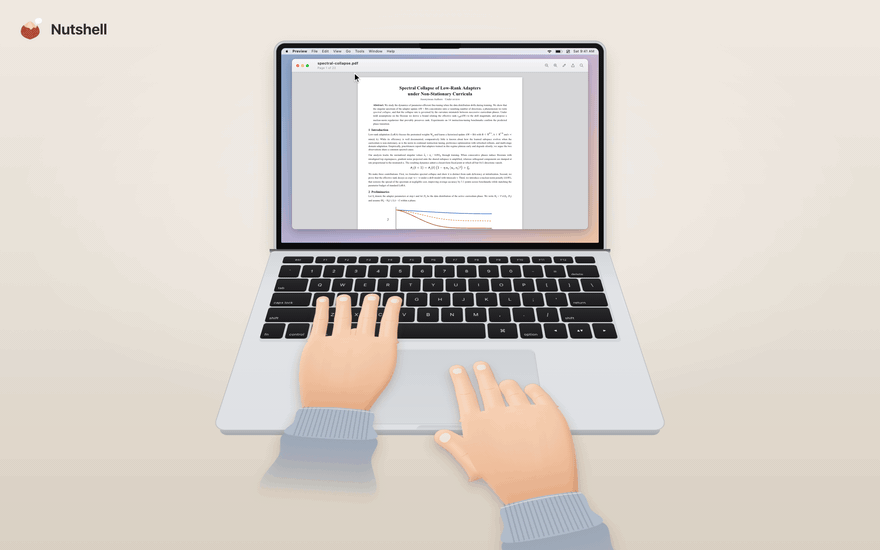

<div align="center">
  <p>
    
  </p>

**English** | [简体中文](README.zh-CN.md)

<div>
  <a href="https://github.com/Mor-Li/nutshell/releases/latest"></a>
  
  
  
  <a href="LICENSE"></a>
  <a href="https://github.com/Mor-Li/nutshell/commits/main"></a>
  <a href="https://github.com/Mor-Li/nutshell/stargazers"></a>
</div>
</div>
<br>

**Nutshell** is a tiny macOS helper for the moments you're reading something you can't quite follow: a dense paper, a wall of technical docs, a cryptic error, a confusing email. Select it, copy it, double-tap the trackpad with two fingers, and a small window pops up **right next to your cursor** explaining it in plain words. No switching to a browser, no pasting into a chat site, no losing your place.

<p align="center">
  
</p>

## ✨ Highlights

<table>
  <tr>
    <td width="50%" valign="top">⚡ <b>Instant</b><br>Stays resident in the background, so the window appears the moment you trigger it. It never steals focus from the app you're reading in.</td>
    <td width="50%" valign="top">📎 <b>Feed it anything</b><br>Text, PDFs (scanned ones too), screenshots and images, Word / RTF / HTML, source code, several files at once.</td>
  </tr>
  <tr>
    <td width="50%" valign="top">💬 <b>Keep asking</b><br>Every window is a conversation. Type a follow-up at the bottom and it remembers what was said.</td>
    <td width="50%" valign="top">🪟 <b>Many windows at once</b><br>Every trigger opens a new window. Explain a paper here and an error message there, side by side.</td>
  </tr>
  <tr>
    <td width="50%" valign="top">🗂 <b>Nothing is lost</b><br>Every round is saved automatically. Jump back to any earlier conversation from the clock menu, context and images included.</td>
    <td width="50%" valign="top">🧮 <b>Math that reads like math</b><br><code>$…$</code>, <code>$$…$$</code>, <code>\(…\)</code> and <code>\[…\]</code> are typeset with KaTeX, fully offline. Prices like "$5 to $10" stay plain text.</td>
  </tr>
  <tr>
    <td width="50%" valign="top">🔌 <b>Your model, your key</b><br>Any OpenAI-compatible <code>/chat/completions</code> endpoint: OpenAI, Gemini, a company gateway, or a local Ollama.</td>
    <td width="50%" valign="top">🖥 <b>Terminal version too</b><br>A fast, no-agent chat in your terminal that shares the same config. Drag files in to attach them.</td>
  </tr>
</table>

## 🚀 Quick start

<details open>
<summary><b>1. Install</b></summary>

```bash
git clone https://github.com/Mor-Li/nutshell.git
cd nutshell
make install
```

This builds the app, installs it to `~/Applications/Nutshell.app` and launches it. It has **no Dock icon and no window of its own**: it's a background process listening on local port `8823`. No system permissions are needed, because it only reads the clipboard.

Launch at login (run once):

```bash
osascript -e 'tell application "System Events" to make login item at end with properties {path:"'$HOME'/Applications/Nutshell.app", hidden:true}'
```

</details>

<details open>
<summary><b>2. Point it at a model</b></summary>

Edit `~/.config/nutshell/config.json` (created on first launch):

```jsonc
{
  "baseURL": "https://api.openai.com/v1",   // any OpenAI-compatible endpoint
  "model": "gpt-5.4",
  "apiKeyEnvVar": "OPENAI_API_KEY"          // read from your shell, or set "apiKey" directly
}
```

Then reload without restarting: `curl -s http://127.0.0.1:8823/reload`

> [!NOTE]
> The app's own interface text (input placeholder, menus) is currently in Chinese. Answers come back in whatever language your prompt asks for, so rewrite `promptTemplate` in English to get English explanations.

</details>

<details open>
<summary><b>3. Bind a gesture</b></summary>

Anything that can send an HTTP request can trigger Nutshell. With [BetterTouchTool](https://folivora.ai/), a two-finger double-tap (double right-click) works great:

1. In BTT, pick **Normal Mouse** (or your trackpad) and add a **double right-click** trigger
2. Action 1: **Send Keyboard Shortcut** → `⌘C` (so you don't even need to copy yourself)
3. Action 2: **Delay Next Action** → `0.08` seconds
4. Action 3: **Execute Terminal Command (Async, non-blocking)**:

```bash
curl -s http://127.0.0.1:8823/explain
```

Now it's just **select → double-tap**. Hold **⌥** while triggering (or trigger without copying anything new) to open the history list instead.

</details>

## 📖 Usage

<details>
<summary><b>What you can copy</b></summary>

| What you copy | What Nutshell does |
|---|---|
| A piece of text | Explains it directly |
| A PDF file | Extracts the text, then explains |
| A scanned PDF (no text layer) | Renders the first few pages as images and explains from those |
| An image / a screenshot | Sends it to a multimodal model |
| Word, RTF, HTML | Converts to plain text with the built-in `textutil` |
| .txt / .md / .json / .csv / source code | Reads it directly |
| Several files at once | Text is concatenated, up to 6 images are attached |

</details>

<details>
<summary><b>Working with the window</b></summary>

- **Trigger again** → a new window explains the current clipboard, old ones stay. Windows opened at the same spot are staggered
- **⌘W** closes the last window you clicked (or the newest). While a popup is visible, ⌘W belongs to it, so the Chrome tab behind it is never closed by accident
- **Esc** or **×** closes a window
- Click anywhere in the window and type a follow-up at the bottom. **Return** sends, **Shift+Return** adds a line. The input grows up to 8 lines, and the divider above it can be dragged
- If the network drops or the answer breaks off, a **↻ Retry** button resends the last question. It survives reopening from history
- The **copy icon** copies the whole answer. Selecting text and pressing **⌘C** copies just that part
- Drag the top bar to move, drag the edges to resize

</details>

<details>
<summary><b>History</b></summary>

Every round is saved to `~/.config/nutshell/sessions/`, one JSON file per conversation, **append only**. Click the clock in the top-left corner of any popup:

```
┌─────────────────────────────────────┐
│ 🕘  gemini-4-argon            ⧉  ✕ │  ← click the clock
├─────────────────────────────────────┤
   ┌───────────────────────────────┐
   │  ＋ New chat (re-read clipboard) │
   │ ───────────────────────────── │
   │  Today                         │
   │  ✓ SSE reconnect logic…  15:04 │
   │    Transformer attention… 11:22│
   │  Yesterday                     │
   │    What is this email…   22:10 │
   │ ───────────────────────────── │
   │  37 in total · Show in Finder  │
   └───────────────────────────────┘
```

Pick an entry and the window, the model context and any images come back, ready for follow-ups. Hold **Option** to turn an entry into "Delete". The menu lists the latest 30 (`historyMenuCount`).

</details>

<details>
<summary><b>Commands</b></summary>

```bash
curl -s http://127.0.0.1:8823/explain   # explain the clipboard (bind this to your gesture)
curl -s http://127.0.0.1:8823/history   # open the history list directly
curl -s http://127.0.0.1:8823/reload    # reload config.json
pkill -x Nutshell                       # quit
```

</details>

## ⚙️ Configuration

<details>
<summary><b>All fields in <code>~/.config/nutshell/config.json</code></b></summary>

```jsonc
{
  // What gets sent to the model. {content} is replaced with what you copied.
  // The defaults are in Chinese ("explain this in plain, easy words"); write them in any language.
  "promptTemplate": "用通俗易懂的大白话讲一下下面讲的是什么东西：\n\n{content}\n\n用通俗易懂的大白话讲一下上面讲的是什么东西。",
  "imagePromptTemplate": "用通俗易懂的大白话讲一下这张图里讲的是什么东西。",
  "baseURL": "https://api.openai.com/v1",
  "model": "gpt-5.4",
  "apiKeyEnvVar": "OPENAI_API_KEY"
}
```

| Field | What it does |
|---|---|
| `window.width` / `height` / `fontSize` / `gap` | Popup size, body font size, distance from the cursor |
| `port` | Trigger port (default `8823`) |
| `contextWindow` | Model context size in tokens (default 1M). Only used for the "used / total" display. Nothing is ever truncated |
| `maxImages` / `maxScannedPDFPages` | Limits for images per request and pages of a scanned PDF |
| `showMenuBarIcon` | `true` adds a menu bar icon with open config / reload / quit |
| `systemPrompt` | Optional system prompt. The current time is always appended, so the model knows what year it is |
| `historyMenuCount` | How many entries the history menu shows (default 30) |
| `rateLimitRetries` / `rateLimitRetryDelay` | Automatic retries on HTTP 429 (default 6 times, 2 s apart) |

The API key can stay in your shell: Nutshell runs `source ~/.zshrc` to read the variable named by `apiKeyEnvVar`, and re-reads it once on a 401. To try a prompt without the app, run `./scripts/try-prompt.sh "some text"`.

</details>

## 🖥 Terminal version

<details>
<summary><b>Plain back-and-forth chat in your terminal</b></summary>

```bash
uv tool install --editable ./cli    # once
nutshell                            # or: nut
```

- Question and answer only, no tools, no agent, so it's fast. Shares `config.json` with the popup
- Answers are rendered as Markdown while they stream. The whole chat stays in your scrollback, so ⌘A + copy gives you the full log (`/copyall` gets the raw Markdown)
- **Drag files in**: text files are inlined, images are attached, PDFs are sent whole, folders are expanded (respecting `.gitignore`)
- Every answer is saved. `nutshell -r` lists past chats with auto-generated titles, `nutshell -c` continues the latest one
- `--own` / `/own` switches to your own Google AI Studio key (`GEMINI_AI_STUDIO_KEY_NUTSHELL` in `.env`), `/work` switches back

| Command | What it does |
|---|---|
| `/own`, `/work` | Switch backend |
| `/model name`, `/models` | Change model / list available models |
| `/copy`, `/copyall` | Copy the last answer / the whole chat as Markdown |
| `/raw` | Toggle Markdown rendering |
| `/new`, `/resume` | New chat / pick an old one |
| `/exit`, Ctrl+D | Quit |

</details>

## 📰 News

- **2026-11-21** Math rendering in the popup: `$…$`, `$$…$$`, `\(…\)` and `\[…\]` are all typeset, while prices ("$5 to $10") and `$` inside code stay as plain text. Works offline. New flat-style icon without the rounded-square frame. New README with a demo animation.
- **2026-11-20** Pasted content is no longer truncated, and the title bar shows how many tokens the conversation has used. The input box grows as you type and can be resized by dragging. If an answer breaks off halfway, a "↻ Retry" button appears. The app gets its own icon.
- **2026-11-12** New terminal version: chat with Gemini in the terminal, drag files in to attach them, see answers rendered as Markdown, and resume earlier conversations.
- **2026-11-11** Every request carries the current time, so the model no longer treats 2026 as "the future".
- **2026-09-06** When explaining an image, the bubble shows the image itself. The same gesture can also open history.
- **2026-08-31** Every trigger opens a new window, so you can compare several side by side. Your own messages are drawn as chat bubbles.
- **2026-08-30** ⌘W closes the popup without closing the Chrome tab behind it.
- **2026-08-16** Fixed ⌘C and ⌘V in the popup.
- **2026-08-14** Automatic retry when rate-limited (HTTP 429).
- **2026-08-13** First release.

## 🛠 Troubleshooting

<details>
<summary><b>Nothing happens when I trigger it</b></summary>

```bash
pgrep -x Nutshell && lsof -nP -iTCP:8823 -sTCP:LISTEN
```

If the port is taken by another program, Nutshell shows a dialog saying so. Change `port`.

</details>

<details>
<summary><b>It can't find the API key</b></summary>

```bash
source ~/.zshrc && echo ${OPENAI_API_KEY: -4}
```

If nothing is printed, the key isn't reachable through `~/.zshrc`. Set `apiKey` in the config instead.

</details>

<details>
<summary><b>HTTP 429 rate limits</b></summary>

Nutshell retries on its own (every 2 seconds, up to 6 times) and shows the attempt number. A message like `max_parallel_requests` means the key's concurrent-request slots are busy, usually because of batch jobs elsewhere. It frees up within seconds.

</details>

## 🗂 Project layout

<details>
<summary><b>Where things are</b></summary>

```
Sources/Nutshell/          The popup app (Swift, AppKit)
  AppDelegate.swift        Coordinator: triggers, windows, history menu
  TriggerServer.swift      Listens on 127.0.0.1:8823
  InputCapture.swift       Turns the clipboard (text / PDF / images / files) into model input
  ExplainWindowController  One conversation per window: ask, follow up, retry, save
  LLMClient.swift          OpenAI-compatible streaming client with 429 retry
  PopoverPanel.swift       The popup itself, positioning, input area
  MarkdownView.swift       WKWebView that renders the answer
  Resources/               viewer.html, marked.js and KaTeX, all bundled, no network
Tests/NutshellTests/       Automated tests (`make test`), no windows, no network
cli/nutshell_cli/          The terminal version (Python, installed with uv)
demo/                      Source of the demo animation and banner (`uv run demo/render.py`)
icon/                      App icon source and build (`uv run scripts/make_icon.py`)
scripts/                   Dev helpers: prompt tester, icon builder, KaTeX vendoring
```

</details>

## 🤝 Contributing

Issues and pull requests are welcome. Please run `make test` before sending a PR. UI changes should come with a test in `Tests/NutshellTests/`.

## 📜 License

[MIT](LICENSE). Use it however you like.
