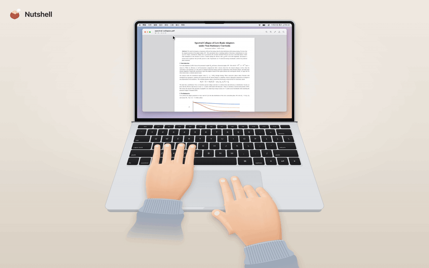

<div align="center">
  <p>
    
  </p>

[English](README.md) | **简体中文**

<div>
  <a href="https://github.com/Mor-Li/nutshell/releases/latest"></a>
  
  
  
  <a href="LICENSE"></a>
  <a href="https://github.com/Mor-Li/nutshell/commits/main"></a>
  <a href="https://github.com/Mor-Li/nutshell/stargazers"></a>
</div>
</div>
<br>

**Nutshell** 是一个 macOS 小工具，专门对付"看不懂"的时刻：一篇绕来绕去的论文、一大段技术文档、一行看不明白的报错、一封云里雾里的邮件。选中、复制、两指在触控板上连点两下，**鼠标旁边**就弹出一扇小窗，用大白话给你讲清楚。不用切到浏览器，不用把内容粘进哪个 AI 网站，读到哪儿还在哪儿。

名字取自英文谚语 *in a nutshell*，意思是"一句话说清"。

<p align="center">
  
</p>

## ✨ 亮点

<table>
  <tr>
    <td width="50%" valign="top">⚡ <b>快</b><br>常驻后台，一触发窗口就出来。不抢焦点，你正在看的那个 app 还在前台。</td>
    <td width="50%" valign="top">📎 <b>什么都能喂</b><br>文字、PDF（扫描版也行）、截图和图片、Word / RTF / HTML、源码，一次选好几个文件也行。</td>
  </tr>
  <tr>
    <td width="50%" valign="top">💬 <b>接着问</b><br>每扇窗都是一段对话。在底下打字追问，它记得前面聊了什么。</td>
    <td width="50%" valign="top">🪟 <b>好几扇窗一起开</b><br>每触发一次就开一扇新窗。这边讲论文，那边讲报错，并排对照着看。</td>
  </tr>
  <tr>
    <td width="50%" valign="top">🗂 <b>聊过的都留着</b><br>每答完一轮自动存盘。点左上角的小钟能回到以前任何一段对话，上下文和图片都接得上。</td>
    <td width="50%" valign="top">🧮 <b>公式排得像公式</b><br><code>$…$</code>、<code>$$…$$</code>、<code>\(…\)</code>、<code>\[…\]</code> 都用 KaTeX 排版，完全不联网。"$5 到 $10" 这种钱数不会被误认成公式。</td>
  </tr>
  <tr>
    <td width="50%" valign="top">🔌 <b>模型和密钥你自己定</b><br>任何 OpenAI 兼容的 <code>/chat/completions</code> 接口都能用：OpenAI、Gemini、公司自己的网关，或者本机的 Ollama。</td>
    <td width="50%" valign="top">🖥 <b>还有终端版</b><br>在终端里跟模型快速来回聊，没有工具、没有 agent，和浮窗共用同一份配置。拖文件进来就能附上。</td>
  </tr>
</table>

## 🚀 快速上手

<details open>
<summary><b>第一步：安装</b></summary>

```bash
git clone https://github.com/Mor-Li/nutshell.git
cd nutshell
make install
```

这会编译、打包、装到 `~/Applications/Nutshell.app` 并启动。它**没有 Dock 图标，也没有自己的主窗口**，就是一个后台进程，守着本机的 `8823` 端口。不需要任何系统权限，因为它只读剪贴板。

开机自启（装完跑一次就行）：

```bash
osascript -e 'tell application "System Events" to make login item at end with properties {path:"'$HOME'/Applications/Nutshell.app", hidden:true}'
```

</details>

<details open>
<summary><b>第二步：配一个模型</b></summary>

编辑 `~/.config/nutshell/config.json`（第一次启动时自动生成）：

```jsonc
{
  "baseURL": "https://api.openai.com/v1",   // 任何 OpenAI 兼容的接口
  "model": "gpt-5.4",
  "apiKeyEnvVar": "OPENAI_API_KEY"          // 从 shell 环境变量里读，也可以直接填 "apiKey"
}
```

改完不用重启，打一下这条命令就生效：`curl -s http://127.0.0.1:8823/reload`

</details>

<details open>
<summary><b>第三步：绑一个手势</b></summary>

任何能发 HTTP 请求的东西都能叫醒 Nutshell。用 [BetterTouchTool](https://folivora.ai/) 绑"两指连点两下"（也就是双击右键）最顺手：

1. 在 BTT 里选 **Normal Mouse**（或你的触控板），添加一个**双击右键**触发
2. 动作一：**Send Keyboard Shortcut** → `⌘C`（这样连复制都替你按了）
3. 动作二：**Delay Next Action** → `0.08` 秒
4. 动作三：**Execute Terminal Command (Async, non-blocking)**：

```bash
curl -s http://127.0.0.1:8823/explain
```

之后就只剩**选中 → 连点两下**。按着 **⌥** 触发，或者没复制新东西就触发，弹出来的是历史清单。

</details>

## 📖 用法

<details>
<summary><b>能复制什么</b></summary>

| 你复制的东西 | Nutshell 怎么处理 |
|---|---|
| 一段文字 | 直接解读 |
| 一个 PDF 文件 | 提取文字后解读 |
| 扫描版 PDF（没有文字层） | 把前几页渲染成图片，看图讲 |
| 一张图 / 一张截图 | 交给多模态模型看图讲 |
| Word、RTF、HTML | 用系统自带的 `textutil` 转成纯文字 |
| .txt / .md / .json / .csv / 源码 | 直接读 |
| 一次选中好几个文件 | 文字拼在一起，图片最多带 6 张 |

</details>

<details>
<summary><b>窗口怎么用</b></summary>

- **再触发一次** → 再开一扇新窗解读当前剪贴板，旧窗不动。同一位置连着开会自动错开
- **⌘W** 关掉你最后点过的那扇（都没点过就关最新的）。浮窗露着脸的期间 ⌘W 归它，后面 Chrome 的标签页不会被误关
- **Esc** 或右上角 **×** 关掉一扇
- 点窗口任意位置，就能在底部输入框接着问。**回车**发送，**Shift+回车**换行。输入框最多自己长到 8 行，上面那根分隔线可以拖
- 网断了或者答到一半中断了，会出现 **↻ 重试** 按钮，把刚才那一问重新发一遍。关了窗从历史里翻出来，按钮还在
- 右上角的**复制图标**拷走整段回答。正文里划选一段再按 **⌘C**，只拷这一段
- 拖顶栏挪窗，拖边角改大小

</details>

<details>
<summary><b>历史对话</b></summary>

每答完一轮就存到 `~/.config/nutshell/sessions/`，一段对话一个 JSON 文件，**只增不删**。点任意一扇浮窗左上角的小钟：

```
┌─────────────────────────────────────┐
│ 🕘  gemini-4-argon            ⧉  ✕ │  ← 点这个钟
├─────────────────────────────────────┤
   ┌───────────────────────────────┐
   │  ＋ 新对话（重读剪贴板）        │
   │ ───────────────────────────── │
   │  今天                          │
   │  ✓ SSE 断线重连那段…    15:04  │
   │    Transformer 注意力…  11:22  │
   │  昨天                          │
   │    这封邮件在说啥…      22:10  │
   │ ───────────────────────────── │
   │  共 37 条 · 在访达中打开        │
   └───────────────────────────────┘
```

点哪条切哪条，窗口、模型那边的上下文、图片都会恢复，直接接着问。按住 **Option**，某一条会变成"删除这条"。菜单默认列最近 30 条（`historyMenuCount`）。

</details>

<details>
<summary><b>几条命令</b></summary>

```bash
curl -s http://127.0.0.1:8823/explain   # 解读剪贴板（手势绑的就是这条）
curl -s http://127.0.0.1:8823/history   # 直接叫出历史清单
curl -s http://127.0.0.1:8823/reload    # 改完配置重新加载
pkill -x Nutshell                       # 退出
```

</details>

## ⚙️ 配置

<details>
<summary><b><code>~/.config/nutshell/config.json</code> 里的所有字段</b></summary>

```jsonc
{
  // 发给模型的话。{content} 会被替换成你复制的内容
  "promptTemplate": "用通俗易懂的大白话讲一下下面讲的是什么东西：\n\n{content}\n\n用通俗易懂的大白话讲一下上面讲的是什么东西。",
  // 复制的是图片时用这句
  "imagePromptTemplate": "用通俗易懂的大白话讲一下这张图里讲的是什么东西。",
  "baseURL": "https://api.openai.com/v1",
  "model": "gpt-5.4",
  "apiKeyEnvVar": "OPENAI_API_KEY"
}
```

| 字段 | 作用 |
|---|---|
| `window.width` / `height` / `fontSize` / `gap` | 浮窗大小、正文字号、离鼠标多远 |
| `port` | 触发端口，默认 `8823` |
| `contextWindow` | 模型的上下文有多大（token），默认 100 万。只用来在顶栏显示"用了多少 / 一共多少"，不截断任何内容 |
| `maxImages` / `maxScannedPDFPages` | 一次最多带几张图、扫描版 PDF 最多看几页 |
| `showMenuBarIcon` | 改成 `true` 会在菜单栏放个图标，里面有打开配置、重载、退出 |
| `systemPrompt` | 系统提示词，可不填。程序每次都会在后面接一句当前时间，免得模型不知道今年是哪年 |
| `historyMenuCount` | 历史菜单列几条，默认 30 |
| `rateLimitRetries` / `rateLimitRetryDelay` | 撞上限流（HTTP 429）自动重试几次、隔几秒，默认 6 次、2 秒 |

API key 可以不写进配置：程序会 `source ~/.zshrc` 去读 `apiKeyEnvVar` 指定的那个变量，撞到 401 会自动重读一次。想不开 app 单独试 prompt，用 `./scripts/try-prompt.sh "要解读的内容"`。

</details>

## 🖥 终端版

<details>
<summary><b>在终端里跟模型来回聊</b></summary>

```bash
uv tool install --editable ./cli    # 装一次
nutshell                            # 或者敲短的：nut
```

- 就是一问一答，没有工具、没有 agent，所以快。和浮窗共用 `config.json`
- 回答一边收一边按 Markdown 排好版。整段对话都留在终端里，⌘A 复制就是完整记录（`/copyall` 拿 Markdown 原文）
- **拖文件进来**：文字文件贴全文，图片作为附件，PDF 整个发过去，文件夹逐个展开（跳过 `.gitignore` 忽略的）
- 每条回答都自动存盘。`nutshell -r` 列出以前的对话（标题是模型自动起的），`nutshell -c` 接着最近那段
- 网关地址和密钥从 `LITELLM_BASE_URL`、`LITELLM_API_KEY` 读，可以设成环境变量，也可以写进仓库根目录的 `.env`（照 `.env.example` 填）
- `--own` 或 `/own` 切到自己的 Google AI Studio key（写在 `.env` 的 `GEMINI_AI_STUDIO_KEY_NUTSHELL`），`/work` 切回来

| 命令 | 作用 |
|---|---|
| `/own`、`/work` | 切换后端 |
| `/model 名字`、`/models` | 换模型 / 列出能用的模型 |
| `/copy`、`/copyall` | 复制上一条回答 / 整段聊天（Markdown 原文） |
| `/raw` | 开关 Markdown 渲染 |
| `/new`、`/resume` | 开新对话 / 挑一段旧的接着聊 |
| `/exit`、Ctrl+D | 退出 |

</details>

## 📰 更新记录

- **2026-11-21** 浮窗能排数学公式了：`$…$`、`$$…$$`、`\(…\)`、`\[…\]` 四种写法都认，钱数（"$5 到 $10"）和代码里的 `$` 不会被误当成公式，不联网。图标换成扁平风，去掉了外面那圈方框。README 重写，加了演示动画。
- **2026-11-20** 粘贴进来的内容不再截断，顶栏实时显示这段对话用了多少 token。底部输入框会随字数自己长高，也能拖着调高度。回答到一半断了，底下有「↻ 重试」按钮。app 有了自己的图标。
- **2026-11-12** 加了终端版：在终端里跟 Gemini 来回聊，拖文件进来原地附上内容，回答按 Markdown 排好版显示，随时能接着以前的对话聊。
- **2026-11-11** 每次请求自动带上当前时间，模型不会再把 2026 年当成"未来"。
- **2026-09-06** 解读图片时，气泡里直接贴出那张图。同一个手势也能翻历史。
- **2026-08-31** 每触发一次都弹一扇新窗，几扇窗并排对照看。你问的话画成聊天气泡。
- **2026-08-30** ⌘W 关浮窗，后面 Chrome 的标签页不会被误关。
- **2026-08-16** 修好浮窗里的 ⌘C、⌘V。
- **2026-08-14** 被限流（HTTP 429）时自动重试。
- **2026-08-13** 第一版。

## 🛠 排查问题

<details>
<summary><b>触发了没反应</b></summary>

```bash
pgrep -x Nutshell && lsof -nP -iTCP:8823 -sTCP:LISTEN
```

端口要是被别的程序占了，Nutshell 会直接弹框告诉你。换个 `port` 就行。

</details>

<details>
<summary><b>说找不到 API key</b></summary>

```bash
source ~/.zshrc && echo ${OPENAI_API_KEY: -4}
```

什么都没打出来，说明 key 不在 `~/.zshrc` 这条链路上。直接在配置里填 `apiKey` 也行。

</details>

<details>
<summary><b>撞上 429 限流</b></summary>

不用管，它自己会重试（每 2 秒一次，最多 6 次），窗里会显示第几次。看到 `max_parallel_requests` 的意思是这个 key 同时能跑的请求占满了，多半是别处在跑批量任务，几秒就松。

</details>

## 🗂 目录结构

<details>
<summary><b>东西都在哪</b></summary>

```
Sources/Nutshell/          浮窗版（Swift，AppKit）
  AppDelegate.swift        总调度：触发、窗口、历史菜单
  TriggerServer.swift      守着 127.0.0.1:8823
  InputCapture.swift       把剪贴板（文字 / PDF / 图片 / 文件）整理成模型输入
  ExplainWindowController  一扇窗一段对话：发问、追问、重试、存档
  LLMClient.swift          OpenAI 兼容的流式请求，带 429 重试
  PopoverPanel.swift       浮窗本体、定位、输入区
  MarkdownView.swift       渲染回答的网页视图
  Resources/               viewer.html、marked.js 和 KaTeX，全部内嵌，不联网
Tests/NutshellTests/       自动化测试（`make test`），不弹窗、不联网
cli/nutshell_cli/          终端版（Python，用 uv 装）
demo/                      演示动画和横幅图的源文件（`uv run demo/render.py`）
icon/                      app 图标的原图和成品（`uv run scripts/make_icon.py`）
scripts/                   开发辅助：试 prompt、做图标、更新 KaTeX
```

</details>

## 🤝 参与贡献

欢迎提 issue 和 PR。提 PR 前请先跑一遍 `make test`。改了界面的话，在 `Tests/NutshellTests/` 里补上对应的测试。

## 📜 许可证

[MIT](LICENSE)，随便用。
